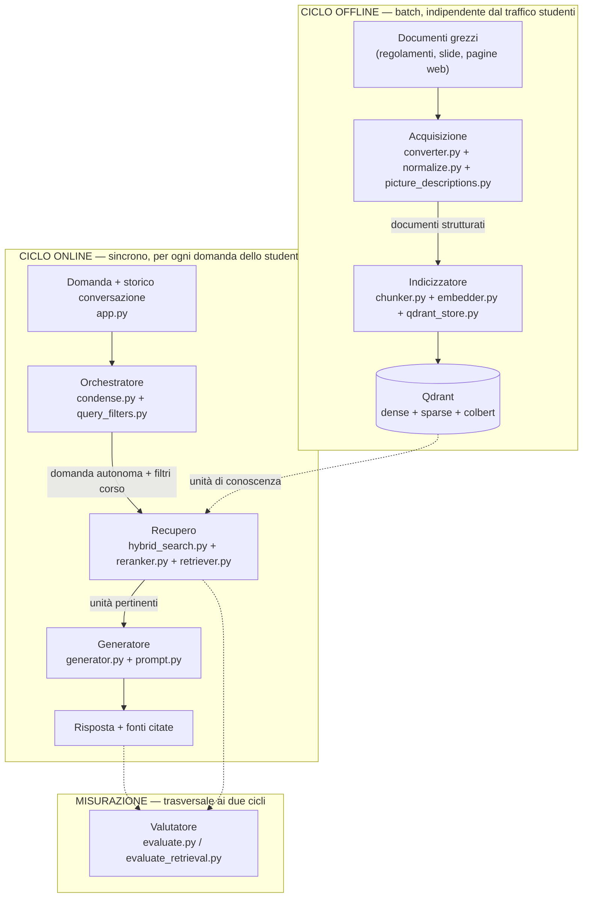
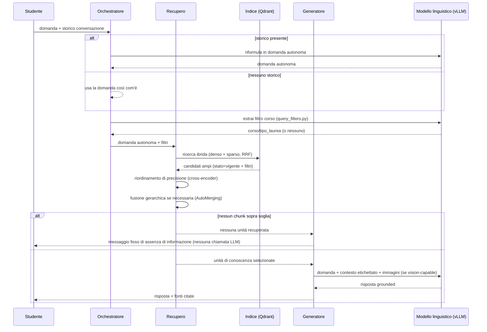

# Relazione Tecnica — Assistente RAG per l'Assistenza Universitaria

Questa relazione descrive il sistema `rag_unibo` procedendo dal generale al particolare: analisi dei requisiti, design architetturale, scelte tecnologiche, design di dettaglio, problematiche incontrate e come sono state risolte, valutazione sperimentale, limiti noti e sviluppi futuri. È stata ricostruita analizzando lo stato attuale del codice, della configurazione e dei risultati di valutazione presenti nel repository, non da una descrizione a priori del sistema.

---

## 1. Analisi dei requisiti

### 1.1 Il bisogno

Uno studente universitario deve orientarsi in un volume enorme di informazione eterogenea e dispersa: regolamenti amministrativi (tasse, scadenze, requisiti di ammissione), materiali didattici (slide, dispense, articoli scientifici), procedure operative (come iscriversi, come cambiare corso, come richiedere un'esenzione). Questa informazione cambia nel tempo, è distribuita su decine di documenti diversi, e le domande reali sono spesso puntuali ("quando scade la prima rata?") o composite ("quali sono le diverse modalità di pagamento?"). Un assistente conversazionale che risponda direttamente a queste domande, invece di costringere lo studente a cercare a mano nei PDF, è il bisogno che il progetto affronta.

### 1.2 Vincoli che definiscono il problema

Tre vincoli escludono a priori intere classi di soluzione:

1. **Riservatezza.** I documenti d'ateneo possono includere dati sensibili. L'intera infrastruttura gira **in locale**: nessuna chiamata a un servizio LLM cloud di terze parti — Qdrant e il motore di inferenza (vLLM) sono servizi Docker sulla stessa macchina ([docker-compose.yml](docker-compose.yml)), e i modelli di embedding/reranking girano nel processo host ([src/config.py](src/config.py)).
2. **Hardware limitato.** GPU dedicate ma di capacità contenuta (16 GB indicativi a scheda). `docker-compose.yml` assegna la GPU del modello generativo tramite `VLLM_DEVICE_ID`, tenendo separata la GPU per embedding/reranking (`EMBEDDINGS_DEVICE_ID`) — le due non competono mai per la stessa richiesta nello stesso istante. Questo esclude i modelli linguistici di grandi dimensioni e impone di dimensionare ogni componente della pipeline per convivere sullo stesso budget.
3. **Precisione fattuale come priorità assoluta.** Il sistema deve rispondere a domande su scadenze e importi. Una risposta fluida ma con una data sbagliata è **peggio** di "non lo so". Questo vincolo attraversa ogni scelta a valle: il prompt di sistema istruisce esplicitamente il modello a riportare "date, importi e numeri esattamente come appaiono nel contesto, senza arrotondare o parafrasare" ([src/generation/prompt.py:15-16](src/generation/prompt.py#L15-L16)), le tabelle non vengono mai riassunte durante la conversione, e quando il recupero non produce nulla il sistema **non interpella nemmeno il modello**: restituisce un messaggio fisso di assenza di informazione ([src/generation/generator.py:54-60](src/generation/generator.py#L54-L60)) — osservato in pratica che, lasciato decidere, il modello preferisce inventare una risposta plausibile (persino una falsa citazione `[Fonte: ...]`) piuttosto che ammettere l'assenza di contesto.

Un quarto fattore, non un vincolo ma una caratteristica del dominio, complica ulteriormente il problema: l'**eterogeneità documentale**. Regolamenti con gerarchia normativa rigida e tabelle dense, slide con layout bidimensionale e contenuto prevalentemente visivo (diagrammi, schemi), pagine web scaricate con un crawler dedicato ([src/ingestion/web_crawler.py](src/ingestion/web_crawler.py)) — un'unica pipeline di elaborazione deve gestire tutti senza perdere struttura o contenuto.

### 1.3 Perché non basta un LLM generico

Un modello linguistico interrogato direttamente ha tre limiti strutturali: non conosce i documenti specifici dell'ateneo, non riflette gli aggiornamenti recenti (scadenze e importi cambiano ogni anno accademico), e — in assenza di un contesto verificabile — tende a produrre risposte plausibili ma non verificate quando non sa qualcosa. Su un dominio dove l'errore numerico ha conseguenze reali (una tassa pagata in ritardo per una data inventata), questo è inaccettabile.

### 1.4 Perché Retrieval-Augmented Generation

La soluzione architetturale è separare **cosa il sistema sa** (i documenti reali, aggiornabili indipendentemente) da **come il sistema si esprime** (il modello linguistico). Ad ogni domanda, il sistema recupera prima i frammenti più pertinenti, poi chiede al modello di rispondere usando solo quel contesto, citando la fonte. Questo non elimina il rischio di errore (il modello può comunque interpretare male un numero presente nel contesto — vedi §7), ma lo rende verificabile e misurabile (§6).

---

## 2. Design architetturale

### 2.1 I sei componenti

| Componente | Responsabilità | Riceve | Produce |
|---|---|---|---|
| **Acquisizione** | Trasforma documenti eterogenei (PDF, DOCX, PPTX, HTML) in una rappresentazione testuale strutturata e uniforme | Documenti grezzi | Documenti strutturati (testo, tabelle, immagini descritte) |
| **Indicizzatore** | Organizza la conoscenza in unità recuperabili e le rende ricercabili per significato | Documenti strutturati | Indice ricercabile di unità di conoscenza |
| **Orchestratore** | Gestisce lo stato della conversazione, riformula le domande implicite in domande autonome | Domanda + storico conversazione | Domanda autonoma, pronta per la ricerca |
| **Recupero** | Dato un bisogno informativo, seleziona le unità di conoscenza più pertinenti | Domanda autonoma + indice | Insieme di unità di conoscenza pertinenti |
| **Generatore** | Sintetizza una risposta in linguaggio naturale, vincolata al contenuto recuperato | Domanda + unità recuperate | Risposta con citazione delle fonti |
| **Valutatore** | Misura la qualità del sistema lungo l'intera catena | Domande di test + risposte prodotte | Metriche di qualità per stadio |

### 2.2 Diagramma dei due cicli

Il sistema separa un ciclo **offline** (batch, prepara la conoscenza) da uno **online** (sincrono, per ogni domanda):

### 2.3 Il contratto tra componenti

Ogni componente potrebbe essere sostituito con un'implementazione diversa senza che gli altri se ne accorgano, purché il contratto di input/output resti lo stesso. Il componente di Recupero, ad esempio, non sa come l'Indicizzatore ha organizzato l'indice internamente — sa solo che, data una domanda, può interrogarlo e ottenere unità di conoscenza pertinenti.

### 2.4 Perché due cicli separati

Separare offline da online discende direttamente dal vincolo hardware (§1.2). L'Acquisizione, quando deve descrivere il contenuto visivo di centinaia di immagini, può permettersi di essere lenta — non c'è uno studente in attesa. Il Generatore, al contrario, deve rispondere in tempo ragionevole a più studenti in contemporanea. Tenerli separati permette di dimensionare le risorse GPU in modo diverso per i due cicli.

---

## 3. Scelte tecnologiche

| Componente | Strumento concreto | Motivazione sintetica |
|---|---|---|
| Acquisizione | **Docling** (parsing PDF/DOCX/PPTX/HTML) + modello di generazione riusato per le didascalie immagine | Supporto nativo multi-formato con riconoscimento layout, OCR e struttura tabelle in un solo strumento |
| Indicizzazione | **LlamaIndex** (`DoclingNodeParser` + `HybridChunker`) + **BGE-M3** (embedding) + **Qdrant** (vector store) | LlamaIndex si integra nativamente col modello dati di Docling; BGE-M3 produce in un solo modello tre rappresentazioni complementari (dense, sparse/lessicale, ColBERT multi-vettore); Qdrant supporta nativamente ricerca ibrida multi-vettore e filtraggio sui metadati |
| Orchestrazione conversazionale | Lo stesso LLM di generazione, con un prompt dedicato e `max_tokens=200` | Non serve un modello separato per condensare una domanda di follow-up; il passaggio viene saltato del tutto quando non c'è storico ([condense.py:81-82](src/generation/condense.py#L81-L82)) |
| Recupero | Ricerca ibrida (RRF denso+sparso) + **BGE-Reranker-v2-m3** (cross-encoder) + fusione gerarchica (`AutoMergingRetriever`) | La ricerca vettoriale da sola non è abbastanza precisa; il reranker valuta query e testo insieme; la fusione gerarchica risolve i casi dove nessun singolo frammento è mai giudicato pertinente da solo (§5.4) |
| Generazione | Un LLM quantizzato (AWQ), servito con **vLLM** | vLLM offre continuous batching per servire più studenti in concorrenza entro il budget di una singola GPU |
| Valutazione | **RAGAS** (metriche giudicate da LLM) + metriche deterministiche Top-1/Top-5 fatte in casa | Le due famiglie rispondono a domande diverse — qualità percepita end-to-end vs. sola qualità del recupero (§6) |
| Interfaccia | **Chainlit** ([src/app.py](src/app.py)) | Interfaccia conversazionale pronta all'uso, con streaming della risposta e visualizzazione delle fonti recuperate |

### 3.1 Il vincolo hardware come forza trainante

Il `docker-compose.yml` dedica un'intera GPU (`VLLM_DEVICE_ID`) al modello generativo — priorità a latenza e concorrenza multi-studente — tenendo una seconda GPU (`EMBEDDINGS_DEVICE_ID`) per i modelli "leggeri" (embedding BGE-M3, reranker), che possono condividere risorse perché non competono mai per la stessa richiesta nello stesso istante. Il modello generativo stesso è quantizzato AWQ per stare nel budget di memoria disponibile.

### 3.2 Una scelta attualmente in bilico: il modello generativo e la comprensione visiva

Il progetto ha esplorato e confrontato quattro modelli generativi candidati (§6.4): Qwen2.5-14B-Instruct-AWQ, Qwen2.5-7B-Instruct-AWQ, Mistral-Nemo-Instruct-12B-AWQ e Meta-Llama-3.1-8B-Instruct. **Al momento di questa relazione, il file `.env` locale ha `VLLM_MODEL_ID=casperhansen/mistral-nemo-instruct-2407-awq` e `GENERATION_MODEL_VISION=false`** — cioè il sistema è attualmente configurato per servire Mistral-Nemo-12B, un modello **non vision-capable**. Questo ha due conseguenze dirette sul design descritto nei capitoli precedenti:

- `do_picture_description` nella pipeline di Acquisizione è disattivato ([converter.py:39-41](src/ingestion/converter.py#L39-L41)): le immagini nei documenti convertiti **non ricevono didascalia automatica** con questa configurazione.
- Il prompt del Generatore non allega più le immagini originali ai frammenti recuperati ([prompt.py:73](src/generation/prompt.py#L73) è condizionato da `generation_model_vision`), quindi le domande `image_grounded` del dataset diagnostico (§6.4) sono servite oggi solo tramite le didascalie testuali già indicizzate in precedenza, se presenti.

Questo è in tensione diretta con i risultati di valutazione (§6.4), che indicano Qwen2.5-14B come il modello con la qualità più alta e come l'unico dei quattro a raggiungere il punteggio massimo sulle domande `image_grounded`. La configurazione attuale privilegia evidentemente latenza/costo rispetto a qualità massima — una scelta legittima, ma che andrebbe resa esplicita e verificata rispetto al caso d'uso reale piuttosto che lasciata implicita in un `.env` non versionato (vedi §7).

---

## 4. Design di dettaglio (dettagli implementativi)

### 4.1 Acquisizione

**File**: [src/ingestion/converter.py](src/ingestion/converter.py), [src/ingestion/normalize.py](src/ingestion/normalize.py), [src/ingestion/picture_descriptions.py](src/ingestion/picture_descriptions.py), [src/ingestion/web_crawler.py](src/ingestion/web_crawler.py)

Riceve i documenti grezzi (`datasets/raw/`) e produce, per ciascuno, una coppia di file in `datasets/converted/`: un JSON strutturato (`DoclingDocument`, usato dagli stadi successivi) e un Markdown leggibile. La struttura di cartelle sotto `datasets/raw/`/`datasets/converted/` è preservata dal convertitore ed **è** lo schema dei metadati (§4.2) — ogni livello di cartella (`tipo_laurea/corso/sezione/materia`) diventa un campo filtrabile.

Tre passaggi in sequenza:

1. **Parsing** (`converter.py`, `DocumentConverter` di Docling con `PdfPipelineOptions`): OCR, riconoscimento struttura delle tabelle (`do_cell_matching=True`), estrazione immagini, didascalia via API (§3.2).
2. **Normalizzazione** (`normalize.py`): corregge difetti di parsing sistematici osservati sui documenti reali — dettagliato al §5.1.
3. **Didascalia delle immagini** (`picture_descriptions.py`): quando `generation_model_vision=True`, ogni immagine sopra una soglia di area (`picture_area_threshold=0.005`, calibrata per slide dove un diagramma legittimo occupa spesso solo l'1-2% della pagina) viene passata al modello generativo via API OpenAI-compatibile, con un prompt dedicato in italiano e `picture_area_threshold`/`concurrency=2` — dettagliato al §5.2.

Il crawler web ([web_crawler.py](src/ingestion/web_crawler.py)) è un componente di acquisizione alternativo per pagine `unibo.it`: rispetta `robots.txt`, applica un delay configurabile (`crawl_delay_seconds`), e resta entro lo scope del dominio radice.

**Contratto in uscita**: un documento strutturato dove testo, tabelle (letterali, mai riassunte) e immagini (con relativa didascalia) sono rappresentati in modo uniforme.

### 4.2 Indicizzatore

**File**: [src/chunking/chunker.py](src/chunking/chunker.py), [src/chunking/metadata.py](src/chunking/metadata.py), [src/embedding/embedder.py](src/embedding/embedder.py), [src/embedding/qdrant_store.py](src/embedding/qdrant_store.py), [src/indexing.py](src/indexing.py)

1. **Segmentazione** (`chunker.py`, `DoclingNodeParser` + `HybridChunker` di `docling_core`, `merge_peers=True`): ogni documento è diviso in chunk fino a `chunk_max_tokens` (512 di default) contati con il tokenizer del modello di embedding stesso (`BAAI/bge-m3`), rispettando i confini semantici. Un passaggio successivo (`_merge_short_leaf_chunks`, aggiunto dopo un fallimento osservato in chat, §5.6) fonde in avanti ogni chunk sotto i 40 token con il successivo dello stesso documento, indipendentemente dall'heading — `merge_peers` da solo fonde solo fratelli con heading identico, lasciando isolate le frasi introduttive di sezione. Ogni chunk riceve id deterministici (`uuid.uuid5`, non casuali per run — necessario per il change-detection incrementale) e metadati derivati dal percorso di cartella (`chunking/metadata.py`, `extract_metadata`) più l'anno accademico corrente e un checksum del sorgente (l'hash binario che Docling stesso calcola, riusato invece di ricalcolarlo).
2. **Struttura gerarchica** (`build_parent_nodes`): i chunk della stessa sezione (stesso `source_path` + stessa sequenza di `headings`) vengono raggruppati in un nodo "genitore" sintetico — solo se la sezione ha 2+ chunk figli — collegato via `NodeRelationship.PARENT/CHILD` di LlamaIndex. Il genitore non viene mai indicizzato/embeddato direttamente: esiste solo per essere risolto da `AutoMergingRetriever` in fase di recupero (§4.3, §5.4).
3. **Vettorializzazione e archiviazione** (`embedder.py`, `qdrant_store.py`): ogni chunk **foglia** (non i genitori) è trasformato da BGE-M3 in tre rappresentazioni — dense (1024 dim, coseno), sparse (pesi lessicali), ColBERT (multi-vettore, `MAX_SIM`) — e inserito in Qdrant insieme al payload di metadati. `indexing.py` orchestra l'intero passaggio in modo **incrementale**: confronta i checksum dei documenti convertiti con quelli già registrati nel docstore (`find_unchunked_files`), rigenera solo i file nuovi/modificati, e purga prima i chunk/vettori stantii dei documenti cambiati (`_purge_changed_documents`) per evitare duplicati.

**Contratto in uscita**: un indice ricercabile per similarità semantica, filtrabile sui metadati (`stato`, `tipo_laurea`, `corso`, `sezione`, `materia`, `anno_accademico`, tutti indicizzati come payload keyword in Qdrant — [qdrant_store.py:45](src/embedding/qdrant_store.py#L45)).

**Il corpus in cifre** (stato attuale, dopo il fix di §5.6): 185 documenti convertiti (68 sotto il corso di laurea in Ingegneria e Scienze Informatiche, 117 sotto la laurea magistrale in Psicologia scolastica e di comunità), 1.113 chunk foglia indicizzati in Qdrant + 126 sezioni genitore (non indicizzate direttamente, usate dall'AutoMerging, §4.3).

### 4.3 Recupero

**File**: [src/retrieval/hybrid_search.py](src/retrieval/hybrid_search.py), [src/retrieval/reranker.py](src/retrieval/reranker.py), [src/retrieval/retriever.py](src/retrieval/retriever.py), [src/retrieval/query_filters.py](src/retrieval/query_filters.py)

Un imbuto a tre stadi, ciascuno più costoso ma più preciso del precedente:

1. **Ricerca ibrida** (`hybrid_search.py`, `search_candidates`): la modalità di default in produzione, `"hybrid_no_colbert"`, effettua due prefetch paralleli in Qdrant (denso, `prefetch_limit=50`; sparso lessicale) e li fonde con **Reciprocal Rank Fusion (RRF)** nativo di Qdrant, senza passare per lo stadio ColBERT — misurato peggiore sul corpus (§6.2). L'unico filtro duro applicato in Qdrant è `stato="vigente"` (validità del documento) — il corso di laurea **non** è un filtro duro (vedi punto 2 e §4.4 per il perché).
2. **Riordinamento di precisione** (`reranker.py`, `BAAI/bge-reranker-v2-m3` normalizzato a [0,1]): un cross-encoder valuta ogni candidato **insieme** alla query — più accurato della sola similarità vettoriale, applicato solo al pool già ristretto (`retrieval_candidate_limit=20`). Subito dopo, viene applicato un **bonus additivo** (`settings.corso_priority_boost=0.1`) ai chunk il cui `corso` coincide con quello noto/preferito per la sessione (`HybridQdrantRetriever._retrieve`, [retriever.py](src/retrieval/retriever.py)) — non un'esclusione, solo una spinta nel ranking.
3. **Fusione gerarchica e selezione finale** (`retriever.py`, `retrieve()`): `AutoMergingRetriever` di LlamaIndex osserva i chunk riordinati (già con il bonus applicato) e li fonde nel loro genitore quando abbastanza fratelli compaiono nel pool (§4.2, §5.4). Si applica poi una soglia di accettazione (`rerank_score_threshold=0.3`) sui migliori `rerank_top_k=5`; se nulla la supera, un meccanismo di ripiego (`fallback_mode="absolute"` di default, soglia più permissiva `merged_threshold=0.12`) evita di restituire zero risultati quando c'è comunque un segnale debole ma reale (§5.4).

**Contratto in uscita**: un piccolo insieme (tipicamente 1-5) di chunk, ciascuno con testo, intestazioni, provenienza documentale e percorsi immagine, ordinati per pertinenza.

### 4.4 Orchestratore

**File**: [src/generation/condense.py](src/generation/condense.py), [src/retrieval/query_filters.py](src/retrieval/query_filters.py), gestione di sessione in [src/app.py](src/app.py)

Riceve la domanda corrente e lo storico della conversazione (`user_session`, ultime `max_history_turns=5` coppie). Se lo storico è vuoto, la domanda passa invariata alla condensazione (nessuna chiamata LLM — [condense.py:81-82](src/generation/condense.py#L81-L82)). Se c'è storico, un prompt dedicato con pochi esempi (few-shot, incluso il caso esplicito della negazione: "e per chi non è a ciclo unico?") riformula la domanda in una versione autonoma, con `max_tokens=200` (alzato da 64 dopo un caso osservato in test manuale: con storico presente, una domanda composta a più parti condensata contro 64 token veniva troncata a metà frase, perdendo un'intera clausola *prima* che la decomposizione (sotto) potesse vederla) e `temperature=0.0`.

Un secondo passaggio, sempre eseguito (indipendentemente dallo storico), **decompone la domanda condensata** in una o più sotto-domande autonome quando individua più richieste informative distinte (`decompose_question`, [condense.py](src/generation/condense.py)) — introdotto per risolvere il caso descritto al §5.4/§6.3, dove una domanda a due parti ("requisiti per la domanda di laurea, e requisiti per l'accesso al corso?") veniva risolta con i chunk di un solo sotto-argomento perché il reranking valutava i candidati contro la domanda combinata. Con una sola richiesta, il modello restituisce la domanda invariata (nessun costo aggiuntivo a valle). Il Recupero (§4.3) esegue poi la ricerca separatamente per ciascuna sotto-domanda e unisce i risultati deduplicati (`retrieve_decomposed`, [retriever.py](src/retrieval/retriever.py)), invece di un singolo passaggio sulla domanda combinata — al costo di una chiamata LLM aggiuntiva a ogni turno, anche per domande a singolo argomento.

Il corso di laurea, quando serve, non viene più chiesto all'inizio della conversazione: `app.py` prova prima a estrarlo dal testo della domanda (come sopra); se non lo trova, esegue comunque il recupero (senza alcuna priorità) e controlla a quali corsi appartengono i chunk effettivamente selezionati (`needs_course_disambiguation`, [query_filters.py](src/retrieval/query_filters.py)). Solo se compaiono chunk di **corsi diversi**, e nessuno di essi è il corso eventualmente già noto da un turno precedente — segno che la domanda è davvero ambigua tra corsi (§5.4/§7) — chiede allo studente quale corso intende, e lo ricorda per il resto della sessione come **priorità** per i turni successivi ([app.py](src/app.py)).

Un punto di design rivisto in corsa: inizialmente il corso risolto (per testo o per domanda esplicita) veniva passato a Qdrant come **filtro duro** (`must`), escludendo fisicamente ogni chunk degli altri corsi. Questo si è rivelato un problema concreto, osservato in test manuale: una domanda su un argomento esclusivo di un *altro* corso (es. una materia specifica insegnata solo lì) restituiva "nessuna informazione trovata" invece della risposta corretta, perché il filtro duro la escludeva a priori dal pool di candidati — anche quando il corso noto era chiaramente sbagliato per quella domanda specifica. La soluzione adottata (coerente con la pratica consolidata dei motori di ricerca — la distinzione `must`/`should` di Elasticsearch e Solr, dove un vincolo "morbido" aggiunge punteggio invece di escludere) tratta il corso come una **priorità di ranking**, non un'esclusione: `search_candidates` non applica mai un filtro duro su `corso` (solo su `stato`), e `HybridQdrantRetriever._retrieve` applica invece un bonus additivo fisso (`settings.corso_priority_boost=0.1`) ai chunk del corso noto, dopo il reranking. Così, a parità di pertinenza vince il corso noto, ma una domanda la cui risposta vive **solo** in un altro corso continua a essere trovata e usata, perché nulla viene mai escluso dal pool di ricerca.

**Contratto in uscita**: una o più domande autonome (più, quando risolvibile, un corso di laurea usato come priorità), pronte per l'Agente di Recupero.

### 4.5 Generatore

**File**: [src/generation/generator.py](src/generation/generator.py), [src/generation/prompt.py](src/generation/prompt.py)

Riceve la domanda condensata (usata anche per la generazione, non solo per la ricerca — così il modello non deve risolvere di nuovo un riferimento implicito come "e per il 2026/27?" contro un contesto recuperato per la sua forma già esplicita) e i chunk recuperati. Il prompt di sistema ([prompt.py:7-26](src/generation/prompt.py#L7-L26)) istruisce il modello a: rispondere solo in italiano; dichiarare esplicitamente quando una domanda non è pertinente all'ateneo, invece di tentare comunque una risposta (§5.3); usare esclusivamente il CONTESTO fornito, riportando numeri esattamente come appaiono; **non riusare informazioni dai turni precedenti** se non ripetute nel contesto del turno corrente (per evitare "contaminazione" tra corsi diversi in conversazioni lunghe); citare la fonte tra parentesi quadre per ogni affermazione. Ogni blocco di contesto è etichettato `[Fonte: <titolo pulito>]` (`clean_source_name`, che normalizza i nomi file scaricati dal crawler). Se `generation_model_vision=True`, le immagini originali associate ai chunk vengono allegate come blocchi immagine separati, non solo la loro didascalia testuale. La generazione è a `temperature=0.0` per riproducibilità.

**Contratto in uscita**: una risposta in linguaggio naturale con citazione delle fonti realmente usate.

### 4.6 Valutatore

**File**: [src/eval/evaluate.py](src/eval/evaluate.py), [src/eval/evaluate_retrieval.py](src/eval/evaluate_retrieval.py), [src/eval/evaluate_model_comparison.py](src/eval/evaluate_model_comparison.py), [datasets/eval/qa_test_set_diagnostic.json](datasets/eval/qa_test_set_diagnostic.json)

Esegue un dataset di 124 domande curate manualmente (con risposta attesa, fonte attesa, ed etichetta diagnostica per categoria di difficoltà — `single_fact`, `multi_fact`, `synthesis`, `conversational_condensation`, `image_grounded`, `distractor`, `out_of_scope`, `no_information`, ecc.) attraverso l'intera pipeline (condensazione → recupero → generazione), e misura separatamente qualità del recupero, della generazione e del risultato end-to-end tramite RAGAS (dettagliato al §6). Una seconda famiglia di metriche, deterministiche (Top-1/Top-5), isola la sola qualità del recupero senza giudice LLM di mezzo (`evaluate_retrieval.py`).

Questa separazione per stadio è ciò che permette di diagnosticare *dove* intervenire quando qualcosa non va (§5.4, §6.3).

### 4.7 Configurazione

**File**: [src/config.py](src/config.py)

Un livello `pydantic-settings` che legge un `.env` non versionato e centralizza indirizzi dei servizi, ID delle GPU, e le soglie numeriche usate dal Recupero. È il punto singolo di verità per la configurazione, ma — come discusso al §3.2 — il suo contenuto attuale (`.env`) non è né documentato né validato contro le scelte che l'evidenza sperimentale (§6) suggerirebbe.

### 4.8 Il flusso completo di una domanda

---

## 5. Problematiche affrontate e soluzioni

Questo capitolo non descrive il sistema come funziona idealmente, ma **come ci si è arrivati**.

### 5.1 La normalizzazione: perché è stata necessaria

Il parser di Acquisizione, per quanto capace, non produce output perfetto su documenti reali (regolamenti scannerizzati, slide con layout irregolare). Osservati sistematicamente ([normalize.py](src/ingestion/normalize.py)): intestazioni d'articolo classificate come testo normale invece che come titoli di sezione (`_fix_mislabeled_article_headers`); titolo di Parte e titolo di Articolo uniti su una riga sola quando avrebbero dovuto restare separati (`_split_merged_part_and_article`); numero e titolo dell'articolo spezzati su due header distinti (`_merge_split_article_number_and_title`); intestazioni/piè di pagina ripetuti che finiscono nel corpo del documento invece di essere scartati (`_strip_repeated_boilerplate`, soglia di 3+ ripetizioni verbatim); paragrafi spezzati su più blocchi quando erano in origine uno solo (`_merge_fragmented_paragraphs`, basato sulla punteggiatura di fine frase mancante); tabelle che, attraversando un cambio pagina, vengono lette come due tabelle separate invece di una sola continua (`_merge_paginated_tables`).

Nessuno di questi è un caso raro: sono difetti sistematici del parsing su questa tipologia di documenti. Il caso delle tabelle spezzate è il più critico rispetto al vincolo di precisione fattuale (§1.2): una tabella di tasse spezzata a metà lascerebbe solo la prima parte recuperabile, con il rischio concreto di citare un importo incompleto.

### 5.2 Il problema delle immagini

Un modello di visione leggero, scelto inizialmente per non gravare sulla GPU dedicata all'indicizzazione, si è rivelato **rotto** — non solo impreciso — sui diagrammi accademici del corpus: su schemi con più elementi connessi da frecce, il modello entrava in un loop di ripetizione, producendo la stessa frase decine di volte fino a esaurire il budget di generazione, senza descrivere nulla del contenuto reale. Questo testo rotto finiva davvero nel contenuto indicizzato e recuperabile, degradando attivamente il recupero per qualunque domanda su quei contenuti visivi.

La soluzione (quando la configurazione lo consente, §3.2) riusa per la sola fase di Acquisizione lo stesso modello linguistico destinato alla generazione delle risposte, quando vision-capable — nessun modello aggiuntivo da caricare. Sono stati inoltre necessari due aggiustamenti ai parametri della didascalia ([picture_descriptions.py](src/ingestion/picture_descriptions.py)): `max_tokens=500` (un diagramma complesso richiede più spazio di un logo) e `repetition_penalty=1.15`, per evitare che lo stesso pattern degenere si ripresentasse. È stata inoltre necessaria una calibrazione della soglia di area minima per considerare un'immagine (`picture_area_threshold=0.005`): il default della libreria (0.05, pensato per pagine di testo dense) scartava silenziosamente diagrammi legittimi su slide 720×540, dove occupano spesso solo l'1-2% della pagina.

### 5.3 Il prompt di generazione: non fidarsi ciecamente del modello

Due difficoltà distinte:

**La citazione delle fonti non è affidabile se lasciata al modello.** L'istruzione "cita la fonte per ogni affermazione" non garantisce che il modello lo faccia in modo sistematico. Dato che il sistema sa già, con certezza, quali chunk sono stati effettivamente recuperati, l'interfaccia (`app.py`) mostra la lista delle fonti **deterministicamente dal codice** a partire dai chunk realmente usati (come elementi `Text` a schermo, [app.py:109-122](src/app.py#L109-L122)), invece di fidarsi che il modello le riproduca correttamente nel testo — l'istruzione di citazione inline resta comunque nel prompt, per le citazioni puntuali dentro il corpo della risposta.

**Il modello deve rifiutare esplicitamente le domande fuori tema.** Senza un'istruzione esplicita, un modello linguistico tende a tentare comunque una risposta a qualunque domanda, anche a saluti o richieste non pertinenti, attingendo alla sua conoscenza generale. È stato necessario un guardrail esplicito nel prompt di sistema ([prompt.py:11-12](src/generation/prompt.py#L11-L12)) — la cui efficacia resta però solo parziale, vedi §6.4 e §7.

### 5.4 La condensazione della query e la fusione gerarchica

Le domande di follow-up ("e quella dopo?", "e per il primo anno?") sono comprensibili per una persona che segue la conversazione, ma inutilizzabili come query di ricerca: cercate letteralmente, non hanno quasi nessuna somiglianza semantica con i documenti pertinenti perché mancano del soggetto reale. La soluzione è la condensazione (§4.4) — con l'ottimizzazione di saltarla del tutto quando non c'è storico, risparmiando latenza e carico GPU.

Un secondo problema, distinto: alcune domande legittime ("quali sono le diverse modalità di pagamento?") restituivano sistematicamente "nessuna informazione trovata", nonostante l'informazione fosse presente. La causa: la segmentazione in chunk da ~512 token divide il documento per sezione tematica, e nessun singolo chunk è mai "dedicato" a un tema trasversale come "le modalità di pagamento in generale" — l'informazione è distribuita su più sezioni. Il reranker non giudica mai un singolo chunk fortemente pertinente a una domanda così ampia, e tutti i candidati restano sotto soglia. La fusione gerarchica (§4.2, §4.3) risolve il problema fondendo i chunk fratelli nel genitore prima di applicare la soglia. Il meccanismo di ripiego (`fallback_mode`) è stato necessario per calibrarla correttamente: applicare la soglia permissiva indiscriminatamente introduceva materiale marginalmente pertinente anche su domande fattuali normali, dove la precisione conta di più — la soluzione applica quindi il ripiego solo quando la soglia standard non produce alcun risultato (`fallback_mode="absolute"`), non su ogni domanda.

### 5.5 Un dataset di valutazione può essere sbagliato quanto il sistema

Non tutte le difficoltà riguardano il sistema stesso: un punteggio di fedeltà al contesto molto basso su un caso di test ha portato a scoprire che il documento sorgente non descriveva affatto la relazione presupposta dalla domanda di test (due presunte "soglie" di reddito in realtà indipendenti, per categorie di esenzione scollegate). La lezione operativa, generale: un punteggio basso non implica automaticamente un difetto del sistema — può essere il caso di test a essere costruito su un presupposto sbagliato, e va sempre verificato contro il documento sorgente prima di intervenire sul codice.

### 5.6 Chunk troppo corti per essere distintivi

Test manuali in chat hanno fatto emergere un fallimento riproducibile su entrambi i corsi: la domanda "cosa deve fare uno studente già iscritto per iscriversi all'anno successivo?" veniva risposta con il contenuto sbagliato — la pagina sull'Obbligo Formativo Aggiuntivo (OFA), non quella sull'iscrizione agli anni successivi. La causa, rintracciata nel docstore: la pagina corretta si apre con una frase introduttiva ("Le due cose da ricordare per proseguire gli studi dopo il primo anno") che il chunker isola in un chunk di sole 13 parole, perché i fratelli successivi hanno heading diversi e `merge_peers=True` fonde solo chunk con **identico** percorso di heading (§4.2). Un chunk così povero di testo produce un embedding troppo debole per competere con un chunk di 435 parole della pagina OFA, il cui sottotitolo interno ("OFA e iscrizioni agli anni successivi al primo") è lessicalmente quasi identico alla domanda — e vince il ranking pur essendo il documento sbagliato. L'AutoMerging (§4.3) non interviene, perché fonde solo fratelli dello stesso documento: i due chunk in competizione appartengono a pagine diverse.

**Soluzione implementata**: un nuovo passaggio in `chunk_documents()` (`_merge_short_leaf_chunks`, [chunker.py](src/chunking/chunker.py)) fonde in avanti, nello stesso documento, ogni chunk sotto una soglia di token (40, usando lo stesso tokenizer del chunker per coerenza con il budget di 512), indipendentemente dall'heading — con un tetto di sicurezza (3× il budget di token) contro fusioni a cascata su documenti con più chunk corti consecutivi. Dopo re-chunking e re-indicizzazione completi del corpus (1113 chunk foglia + 126 sezioni genitore, da 185 documenti), il chunk incriminato è passato da 13 a 80 parole, e la stessa domanda in chat ora recupera e cita correttamente la pagina giusta su entrambi i corsi. **Non ancora rieseguita la valutazione sperimentale completa** (§6) con il corpus ri-chunkato — i numeri del capitolo 6 restano quelli precedenti a questo fix.

---

## 6. Valutazione sperimentale

### 6.1 Due famiglie di metrica, per due domande diverse

L'Agente Valutatore misura tre stadi con metriche giudicate da un LLM (framework **RAGAS**, [src/eval/evaluate.py](src/eval/evaluate.py)): `context_precision`/`context_recall` sul recupero, `faithfulness`/`answer_relevancy` sulla generazione, `answer_correctness`/`answer_similarity` sul risultato finale. A queste si affianca una famiglia di metriche **deterministiche**, Top-1/Top-5 ([evaluate_retrieval.py](src/eval/evaluate_retrieval.py)): la percentuale di domande per cui il documento sorgente atteso compare, rispettivamente, al primo posto o tra i primi cinque risultati — nessun giudice LLM di mezzo, verifica per corrispondenza di titolo documento.

Il giudice LLM **non è un modello esterno**: è lo stesso modello servito da vLLM, riusato via client OpenAI-compatibile ([evaluate.py:253-255](src/eval/evaluate.py#L253-L255)) — una scelta obbligata dal vincolo "tutto in locale" (§1.2), con il limite noto che errori di generazione e di valutazione possono correlare (self-grading).

Ogni metrica risponde a una domanda diversa:

- **`context_precision`** — tra i chunk recuperati, quanti sono effettivamente pertinenti? Penalizza il rumore nel contesto passato al generatore.
- **`context_recall`** — il contesto copre tutte le informazioni della risposta di riferimento? Penalizza le informazioni mancanti, non quelle in eccesso.
- **`faithfulness`** — le affermazioni della risposta generata sono deducibili dal contesto, o inventate? Confronta risposta e contesto, non risposta e verità di riferimento.
- **`answer_relevancy`** — la risposta è pertinente alla domanda posta? Confronta risposta e domanda, ignorando il contesto.
- **`answer_correctness`** — la risposta è allineata alla risposta di riferimento (overlap fattuale + similarità semantica)? La metrica più vicina a "risposta giusta o sbagliata".
- **`answer_similarity`** — quanto la risposta è semanticamente simile alla risposta di riferimento, indipendentemente dalla forma? Più debole di `answer_correctness`.
- **`Top-1` / `Top-5`** — il documento sorgente atteso compare al primo posto / tra i primi cinque? Isola la bontà del recupero da ogni rumore introdotto dal giudice LLM o dalla generazione.

Un limite noto di RAGAS in questo progetto: per `context_recall` e `faithfulness` il giudice deve prima scomporre una risposta in affermazioni atomiche tramite output strutturato — su risposte di riferimento multi-fatto/a elenco, questa scomposizione fallisce in modo sistematico e riproducibile su **11 casi** del dataset (indipendentemente dal modello generativo valutato), che restano privi di punteggio su quella metrica invece di far fallire l'intera valutazione.

### 6.2 Retrieval puro: ablation della pipeline (Top-1/Top-5)

Dataset diagnostico completo (124 casi), 13 configurazioni ([datasets/eval/retrieval_screening/](datasets/eval/retrieval_screening/)):

| Configurazione | Top-1 | Top-5 |
|---|---|---|
| `no_colbert_relative_fallback` | **0.637** | 0.694 |
| `chunk_768_no_colbert` | 0.629 | 0.677 |
| `hybrid_no_colbert` **(default in produzione)** | 0.629 | 0.686 |
| `sparse_only` | 0.629 | 0.686 |
| `chunk_768` | 0.621 | 0.669 |
| `dense_only` | 0.621 | 0.686 |
| `no_colbert_no_reranker` | 0.613 | 0.694 |
| `hybrid` (con stadio ColBERT) | 0.597 | 0.669 |
| `hybrid_relative_fallback` | 0.597 | 0.677 |
| `hybrid_no_reranker` | 0.573 | 0.661 |
| `chunk_256_no_colbert` | 0.532 | 0.686 |
| `chunk_256` | 0.524 | 0.669 |
| `random` (controllo di validità) | 0.016 | 0.065 |

**Lettura.** La fusione RRF senza ColBERT (`hybrid_no_colbert`) resta preferibile ad aggiungere lo stadio ColBERT (`hybrid`): +3,2 punti di Top-1 (0.629 vs 0.597), confermando la scelta di produzione. Il chunking a 512 token (default, implicito nelle righe senza suffisso di chunk) è preferibile sia a 256 (chunk troppo piccoli, danneggiano sistematicamente il recupero: -9,7 punti di Top-1 rispetto a `hybrid_no_colbert`) sia, marginalmente, a 768. `random` chiude come atteso, a conferma che la misura è valida.

**Un punto aperto, non risolto in questa relazione.** La configurazione con il Top-1 più alto in assoluto (`no_colbert_relative_fallback`, 0.637) usa `fallback_mode="relative"` invece di `"absolute"`, il default effettivamente cablato in `retriever.py` (§4.3). Il margine sul default di produzione è piccolo (+0,8 punti) ma sistematico — un candidato concreto per una prossima iterazione (§7).

**Nota metodologica importante.** Questi numeri sono stati misurati con la formulazione **precedente** delle domande del dataset diagnostico, prima che il testo delle domande venisse rivisto per nominare esplicitamente il corso di laurea di riferimento, e **prima** che `evaluate_retrieval.py`/`evaluate_model_comparison.py` estraessero ed applicassero il filtro `corso`/`tipo_laurea` a `retrieve()` — entrambe modifiche fatte in questa stessa sessione di analisi, non ancora ri-eseguite su questi risultati. In precedenza il meccanismo di disambiguazione per corso (§4.4) era usato solo dalla chat live (`app.py`), mai dalla valutazione; ora entrambe le pipeline di valutazione calcolano il vocabolario dei corsi per collezione ed estraggono il filtro per ogni caso, esattamente come `app.py`. Poiché il dataset è deliberatamente costruito con documenti "quasi omonimi" tra i due corsi indicizzati come distrattori reciproci (es. sia Ingegneria e Scienze Informatiche sia Psicologia scolastica e di comunità hanno una propria "Prova Pratica Valutativa" e una propria pagina "Tasse ed esenzioni"), i numeri Top-1/Top-5 qui riportati **sottostimano** la capacità di disambiguazione del sistema reale — ora colmata nella pipeline di valutazione, ma non ancora misurata: ri-eseguire questa valutazione con le modifiche applicate (§7) è il passo naturale successivo.

### 6.3 Confronto tra modelli generativi

Retrieval, reranking e chunking fissati sulla configurazione di riferimento (`hybrid_no_colbert`); solo il modello che genera la risposta varia. Quattro modelli quantizzati eseguibili sull'hardware disponibile, sull'intero dataset diagnostico (124 casi, [datasets/eval/model_comparison/](datasets/eval/model_comparison/)):

| Modello | context_precision | context_recall | faithfulness | answer_relevancy | answer_correctness | answer_similarity | gen. media | gen. P95 |
|---|---|---|---|---|---|---|---|---|
| **Qwen2.5-14B-Instruct-AWQ** | 0.850 | 0.889 | **0.891** | **0.723** | **0.772** | **0.886** | 17.63 s | 44.72 s |
| Qwen2.5-7B-Instruct-AWQ | 0.789 | **0.923** | 0.752 | 0.634 | 0.733 | 0.849 | **7.68 s** | **21.11 s** |
| Mistral-Nemo-12B-AWQ **(configurato in `.env` oggi)** | 0.774 | 0.869 | 0.783 | 0.731 | 0.762 | 0.876 | 10.57 s | 36.44 s |
| Meta-Llama-3.1-8B-Instruct | **0.889** | 0.882 | 0.781 | 0.664 | 0.653 | 0.864 | 7.77 s | 21.59 s |

**Lettura.** Le metriche di recupero (`context_precision`/`context_recall`) dipendono dall'embedder e dal reranker, non dal modello generativo — le differenze tra i quattro (0.77-0.89) sono in parte rumore, in parte artefatto della diversa formulazione della query condensata a monte (ogni modello condensa in modo leggermente diverso). È sulle metriche di generazione ed end-to-end che i modelli si separano nettamente: **Qwen2.5-14B** domina su `faithfulness`, `answer_correctness` e `answer_similarity`, con un margine più ampio proprio su `answer_correctness` — la metrica più vicina al requisito di precisione fattuale del sistema (§1.2) — a un costo di generazione 2-2,3× superiore a Qwen2.5-7B/Llama-3.1-8B. **Mistral-Nemo-12B**, il modello attualmente configurato in `.env`, occupa una posizione intermedia: né il più rapido né il più accurato, con `answer_correctness` 0,762 contro 0,772 di Qwen2.5-14B (differenza contenuta) ma senza supporto visivo (§3.2, perdita secca sulle domande `image_grounded`, vedi sotto).

La scomposizione per `diagnostic_tag` (`answer_correctness`) mostra dove il divario si allarga:

| diagnostic_tag | Qwen2.5-14B | Qwen2.5-7B | Mistral-Nemo-12B | Llama-3.1-8B |
|---|---|---|---|---|
| image_grounded | **0.842** | 0.927 | 0.921 | 0.578 |
| qualitative_negation | 0.748 | 0.599 | **0.753** | 0.618 |
| synthesis | 0.617 | 0.543 | **0.714** | 0.616 |
| out_of_scope | 0.156 | 0.156 | **0.299** | 0.455 |
| no_information | **0.356** | 0.193 | 0.320 | 0.542 |

Su `out_of_scope`/`no_information` (casi in cui il sistema dovrebbe astenersi) **nessuno dei quattro modelli si comporta in modo pienamente soddisfacente** — a conferma che il guardrail di rifiuto nel prompt (§5.3) non è sufficiente da solo, indipendentemente dal modello. Da notare: su questi due tag `answer_correctness` è un indicatore parzialmente fuorviante — penalizza anche un rifiuto comportamentalmente corretto ma formulato con parole diverse dalla risposta di riferimento attesa, quindi i valori bassi qui non vanno letti come "il sistema inventa risposte" senza verificare i casi puntuali.

### 6.4 Conclusione della sezione

Il confronto conferma che la scelta del modello generativo pesa quanto, se non più, delle scelte di indicizzazione: il margine Qwen2.5-14B vs Llama-3.1-8B su `answer_correctness` (+0,12) è dello stesso ordine di grandezza del peggior salto osservato nell'ablation di retrieval (§6.2, ~10 punti Top-1 tra chunk 256 e la configurazione migliore). La configurazione attualmente attiva in `.env` (Mistral-Nemo-12B, senza visione) **non è** quella con il punteggio più alto in nessuna delle tre categorie principali (recupero, generazione, end-to-end) — è un compromesso di latenza che andrebbe validato esplicitamente rispetto al caso d'uso reale (§7), non lasciato come default implicito.

---

## 7. Limiti noti e sviluppi futuri

- **Configurazione di produzione non allineata ai risultati di valutazione.** Il modello attualmente servito da vLLM (Mistral-Nemo-12B, `.env`) non è quello con il punteggio migliore in nessuna categoria RAGAS misurata (§6.3-6.4), e la disattivazione della comprensione visiva (`GENERATION_MODEL_VISION=false`) elimina sia la didascalia automatica delle immagini in Acquisizione sia l'allegazione diretta delle immagini nel prompt di Generazione (§3.2). Andrebbe esplicitata una decisione consapevole (latenza vs. qualità) invece di lasciarla in un file non versionato.
- **La valutazione non esercitava alcuna priorità di corso** (§6.2) — **risolto** in questa sessione: `evaluate_retrieval.py` ed `evaluate_model_comparison.py` (via `evaluate.py`) ora estraggono e applicano `corso` come priorità per ogni caso, come già fa `app.py` — con lo stesso meccanismo a bonus additivo, non filtro duro (vedi §4.4). Non ancora misurato: i numeri Top-1/Top-5/RAGAS riportati in questa relazione (§6.2, §6.3) restano quelli **precedenti** sia a questo fix sia alla revisione filtro→priorità, e vanno considerati un limite inferiore.
- **Il recall della ricerca ibrida può mancare contenuto esistente su query lunghe e lessicalmente sovraccariche del nome del corso.** Osservato in test manuale: "Cosa dicono gli studenti del corso di Laurea Magistrale in Psicologia scolastica e di comunità?" non ha recuperato la pagina di testimonianze esistente e correttamente indicizzata — il contenuto rilevante non è nemmeno entrato nel pool dei 20 candidati prima del reranking, probabilmente perché la ripetizione del nome ufficiale del corso (presente in quasi ogni documento del corpus) diluisce il segnale distintivo della domanda. Diverso dal problema dei chunk corti (§5.6): qui il reranker non ha nemmeno la possibilità di valutare il chunk giusto. Non ancora indagato a fondo né risolto.
- **La decomposizione multi-domanda (§4.4, §5.4) non è ancora stata misurata** dopo l'implementazione — priorità immediata per la prossima iterazione, insieme al ri-calcolo di §6.2/§6.3 con i filtri di corso ora attivi anche in valutazione.
- **Nessuna verifica automatica di fedeltà numerica prima della consegna della risposta.** Il sistema si affida al modello generativo per riportare correttamente date e importi dal contesto — un'allucinazione "sottile" (un numero vero del contesto attaccato al fatto sbagliato) non verrebbe intercettata. È il gap più rilevante rispetto al vincolo di precisione fattuale (§1.2).
- **Il rifiuto su domande fuori tema/senza informazione resta debole**, indipendentemente dal modello generativo usato (§6.3): un'istruzione nel prompt di sistema non basta da sola; un meccanismo di rilevamento dedicato (es. una soglia di confidenza sul recupero, o una classificazione esplicita della domanda) è un'estensione naturale.
- **Nessuna gestione della validità temporale dei documenti.** Il meccanismo di filtraggio su `stato`/`anno_accademico` esiste, ma non c'è ancora una logica che distingua automaticamente un documento in vigore da uno superato quando ne arriva una versione più recente.
- **La fusione gerarchica copre solo la sintesi all'interno di una sezione/documento** (§4.2, §5.4), non l'aggregazione di informazione sparsa su documenti diversi — per quest'ultimo caso è stata appena introdotta la decomposizione della query in sotto-domande (§4.4), ma **non è ancora stata misurata**: richiede di rieseguire la valutazione sperimentale (§6) per verificare se recupera davvero i casi `multi_question`/`synthesis` senza degradare latenza o precisione sulle domande a singolo argomento (una chiamata LLM in più a ogni turno).
- **Il fallback di retrieval `"relative"` non è mai stato adottato come default** nonostante il margine misurato a suo favore su Top-1 (§6.2) — da verificare se il margine si conferma anche sulle metriche RAGAS end-to-end prima di cambiare il default di produzione.

---

## 8. Conclusioni

Il sistema realizza l'obiettivo enunciato al §1: un assistente conversazionale che risponde a domande reali su un corpus documentale eterogeneo e in evoluzione, rispettando i tre vincoli di partenza (esecuzione locale, budget hardware limitato, precisione fattuale). L'architettura a due cicli e sei componenti disaccoppiati (§2) si è dimostrata in pratica adatta a isolare e risolvere problemi via via emersi (§5) senza richiedere riscritture strutturali, e la separazione delle metriche per stadio (§6) ha permesso di attribuire con precisione ogni calo di qualità alla sua causa reale — retrieval, chunking, o scelta del modello generativo. I limiti aperti (§7) sono per lo più incrementali rispetto all'architettura esistente, non strutturali: la direzione più utile per il lavoro successivo è chiudere il divario tra la configurazione effettivamente in esecuzione e quanto l'evidenza sperimentale raccolta in questo stesso repository già indica.
